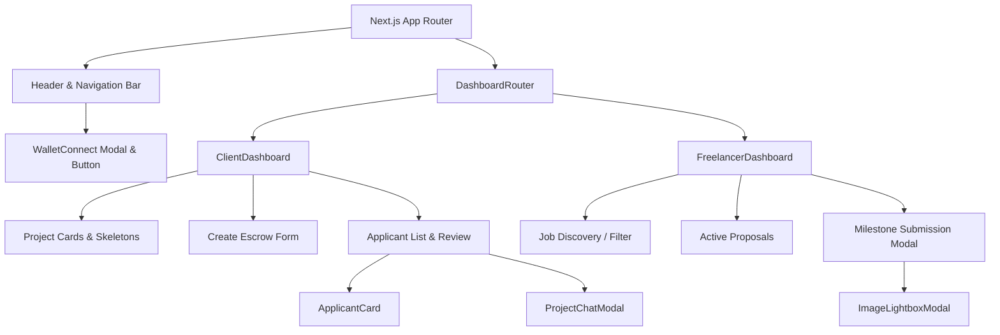

# Component Architecture & UI Directory 🧩

This document details the frontend component hierarchy, UI modularity, state flow, and design system tokens implemented in TrustPay Escrow's Next.js application.

---

## Component Tree Hierarchy



---

## Detailed Component Specifications

### 1. `WalletConnect.tsx`
- **Location:** `frontend/src/components/WalletConnect.tsx`
- **Purpose:** Manages the Freighter browser extension connection lifecycle on the Stellar network.
- **Key Capabilities:**
  - Verifies Freighter installation (`isConnected()`).
  - Requests public key access (`requestAccess()`).
  - Validates active network (`getNetworkDetails()`) and prompts user if not on Testnet/Mainnet.
  - Formats truncated public keys (`G...ABCD`).
  - Synchronizes wallet address to global state via `useWalletStore`.

### 2. `ClientDashboard.tsx`
- **Location:** `frontend/src/components/ClientDashboard.tsx`
- **Tabs:**
  1. **My Projects:** Displays active, disputed, and completed escrows with progress indicators.
  2. **Create Project:** Form to define budget, multi-token selector (`USDC`, `EURC`, `XLM`, `PYUSD`), deadline, Blend yield toggle, and milestone breakdowns.
  3. **Applicants:** Review incoming freelancer proposals, inspect cover notes and portfolio links, and trigger proposal acceptance.

### 3. `FreelancerDashboard.tsx`
- **Location:** `frontend/src/components/FreelancerDashboard.tsx`
- **Purpose:** Dedicated view for contractors and freelancers.
- **Key Capabilities:**
  - Browse public open escrow opportunities.
  - Submit custom quote proposals with milestone delivery timelines.
  - Track active project milestones and trigger milestone delivery submissions (`submit_milestone`).

### 4. `ApplicantCard.tsx`
- **Location:** `frontend/src/components/ApplicantCard.tsx`
- **Props:**
  ```typescript
  export interface ApplicantCardProps {
    applicant: ApplicantCardData;
    onAccept: (id: string) => Promise<void> | void;
    onDeny: (id: string) => Promise<void> | void;
    onOpenChat?: (freelancerAddress: string) => void;
    isProcessing?: boolean;
  }
  ```
- **Features:** One-click Stellar address copying, proposal status badges, direct messaging launcher, and proposal acceptance trigger.

### 5. `ProjectChatModal.tsx`
- **Location:** `frontend/src/components/ProjectChatModal.tsx`
- **Purpose:** Encrypted off-chain direct messaging channel between Client and Freelancer for project scope clarification and milestone file sharing.

### 6. `ImageLightboxModal.tsx`
- **Location:** `frontend/src/components/ImageLightboxModal.tsx`
- **Purpose:** Full-screen zoom and preview modal for project deliverables, mockups, and proof-of-work image attachments.

---

## Design System Tokens & Aesthetics

- **Background Palette:** High-contrast dark mode (`#121212`, `#18181b`, `#1c1c20`).
- **Accent Accents:** Stellar Indigo (`#6366f1`), Emerald Green (`#22c55e`), Amber Warning (`#f59e0b`), Rose Alert (`#ef4444`).
- **Typography:** Inter / system sans-serif font stack with monospace formatting for Stellar addresses (`font-mono`).
- **Loading States:** CSS pulse skeleton loaders (`ProjectCardSkeletonList`) replacing generic spinners.
